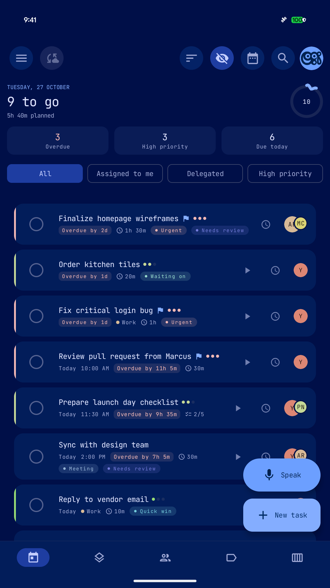
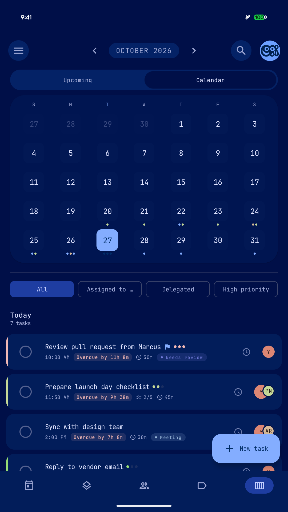
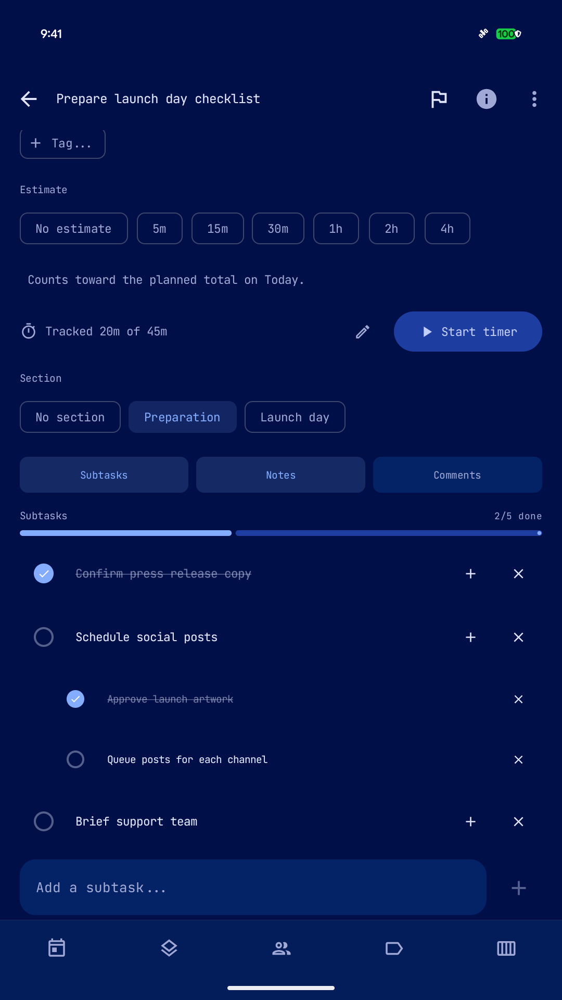
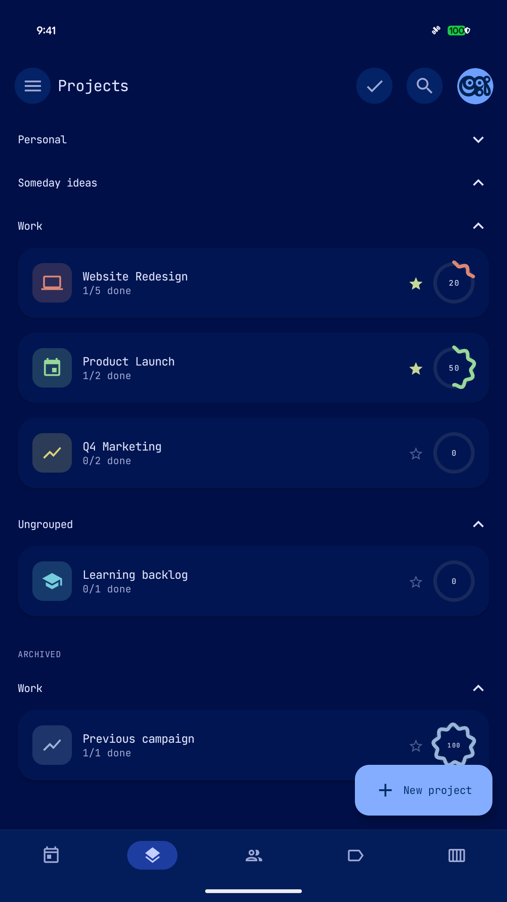
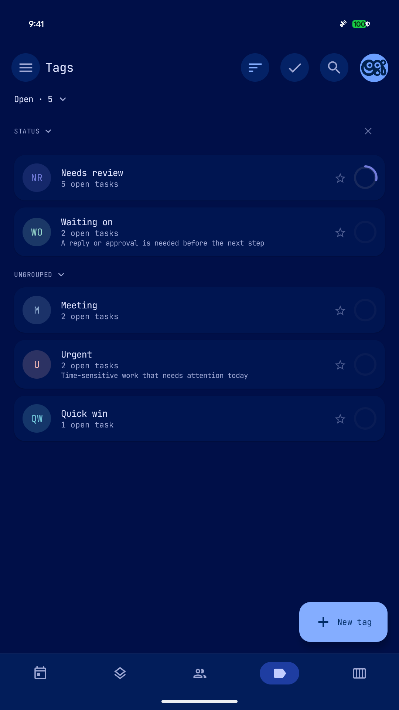
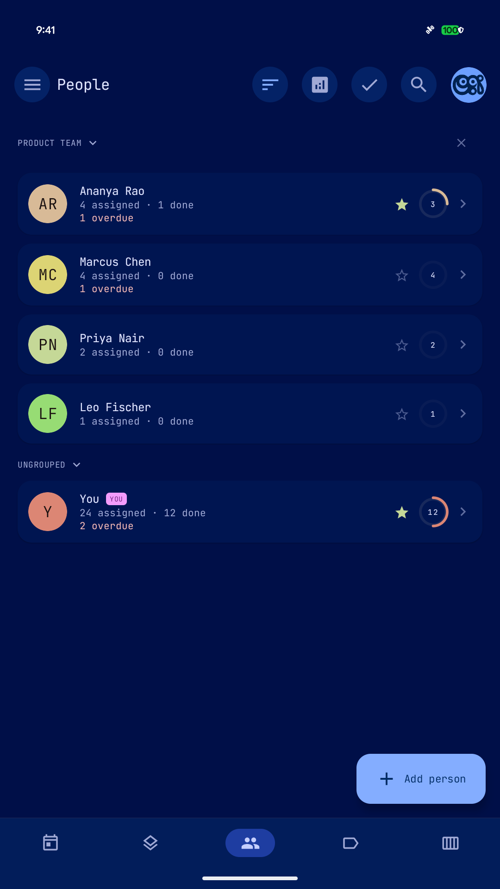
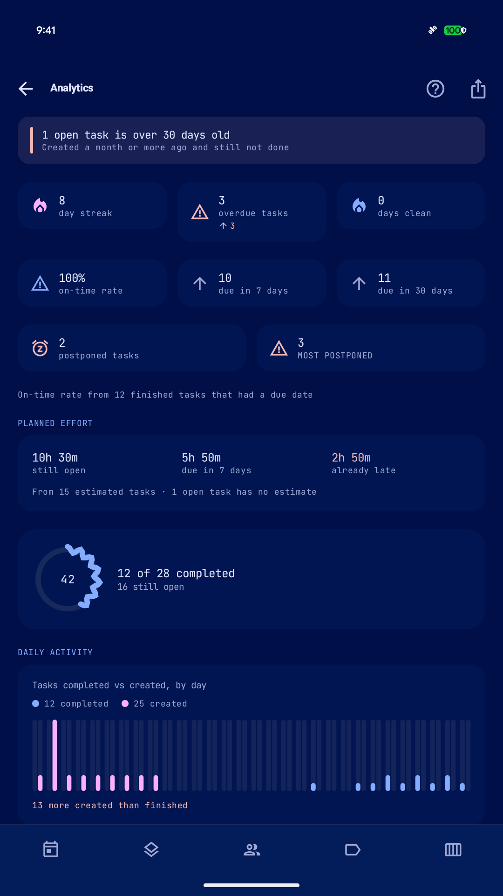

# YATA user guide

YATA (Yet Another To-Do App, pronounced “YAH-tuh”) is an offline-first Android task manager.
You can capture tasks, organize personal and delegated work, plan dates, record effort, and
keep backups in storage you control. No YATA account is required.

This guide describes the current 0.96.x codebase, including the features shipped in 0.96.2
and the Android 16 targeting update in 0.96.3. Screenshots use demo data from 0.96.2 on
27 October 2026. Layout, colors, font, language and available tabs can differ on your device.

[README](../README.md) · [Feature reference](FEATURES.md) · [Sync setup](SYNC_SETUP.md) · [All documentation](README.md)

## Contents

- [Quick start](#quick-start)
- [Navigation](#navigation)
- [Adding tasks](#adding-tasks)
- [Natural-language quick add](#natural-language-quick-add)
- [Daily planning](#daily-planning)
- [Task details and subtasks](#task-details-and-subtasks)
- [Dates, reminders and recurrence](#dates-reminders-and-recurrence)
- [Projects, lists and groups](#projects-lists-and-groups)
- [Tags](#tags)
- [People and delegation](#people-and-delegation)
- [Estimates and focus timer](#estimates-and-focus-timer)
- [Search and saved views](#search-and-saved-views)
- [Bulk actions](#bulk-actions)
- [Analytics and reviews](#analytics-and-reviews)
- [Calendar integration](#calendar-integration)
- [Importing Markdown](#importing-markdown)
- [Other imports, exports and sharing](#other-imports-exports-and-sharing)
- [Widgets and capture shortcuts](#widgets-and-capture-shortcuts)
- [Archive, Trash and undo](#archive-trash-and-undo)
- [Backup and restore](#backup-and-restore)
- [Sync across devices](#sync-across-devices)
- [Settings and languages](#settings-and-languages)
- [App lock and privacy](#app-lock-and-privacy)
- [Demo mode](#demo-mode)
- [Troubleshooting](#troubleshooting)
- [Support and current limitations](#support-and-current-limitations)

## Quick start

1. Download the APK from [GitHub Releases](https://github.com/rjwarrier/yata/releases/latest).
   YATA supports Android 8.0 (API 26) and newer.
2. Open the APK. If needed, allow your browser or file manager to install apps, then complete
   installation and YATA's welcome screens.
3. Open **Today** and tap **New task**.
4. Enter `Buy milk tomorrow 5pm`. Review the highlighted words and the “understood this as”
   preview. The task title should be “Buy milk”, with tomorrow's date and a 5 PM time.
5. Save it. Open **Upcoming**, select tomorrow, and tap the task to inspect its details.
6. Add a subtask or note. Use the completion circle when the work is finished.
7. Open **Settings → Backup & Sync → Backup YATA to File** and save a portable backup.

Start with a small number of tasks. Projects, lists, people and tags are optional; turn on the
features you need in **Settings → Navigation & Features**. For an update, install a release
with the same signing identity over your existing app. Uninstalling or clearing storage removes
local data, so keep a backup before changing installations.

## Navigation

The phone layout provides bottom navigation for enabled destinations. The drawer, opened with
the menu icon, provides additional views, starred items, custom views and tools. Wider screens
adapt navigation and content to the available space.

| Destination | Use it for |
| --- | --- |
| **Today** | Due and overdue work, progress, planned effort and quick filters |
| **Next 10 Days** | A rolling, date-grouped agenda |
| **Upcoming** | A week strip or month calendar with the selected day's agenda |
| **Projects** | Tasks grouped around outcomes, with sections and project groups |
| **Lists** | Reusable task buckets available through navigation and the drawer |
| **People** | Your assignments, delegated work and workload review |
| **Tags** | Labels that cut across projects and lists |
| **Search** | Text search, smart filters and saved views |
| **Analytics** | Completion, aging, postponement and effort trends |
| **Archive / Trash** | Shelved tasks and recently deleted tasks |

The eye control hides or reveals completed tasks on supported screens. Check filters and
completion visibility whenever a view seems unexpectedly empty. Feature visibility and bottom
navigation choices can be changed in Settings.

## Adding tasks

Tap **New task** from a task view, enter a title and review the detected fields. You can use
plain text and set dates, priority, destination and people manually, or let quick add detect them.
Task defaults can prefill fields such as due date, priority and estimate.

Other capture routes include:

- **Speak** for voice input. Availability depends on the device's speech-recognition support
  and installed language resources.
- The **Quick Add** home-screen widget or Quick Settings tile.
- Android's share sheet: share text or a link to YATA and review it as a new task.
- Supported calendar event sharing and `.ics`/`.vcs` files.
- Markdown and CSV imports for larger batches.
- The optional Tasker **Create Task** action, after enabling it in Settings.

Review the task before saving, particularly when the title contains ordinary words that can
also name dates, people or projects.

## Natural-language quick add

YATA uses a local, rule-based parser. Highlighted phrases become task fields, and recognized
phrases are removed from the saved title. It is useful for short task instructions, but long
prose can contain dates you did not intend to schedule.

| Example | What to check in the preview |
| --- | --- |
| `Buy milk tomorrow 3pm` | Tomorrow as the due date, 3 PM as the due time |
| `Team sync next monday` | The detected Monday date |
| `Renew license in 3 days` | A due date three days from now |
| `Gym every monday 7am` | Weekly Monday recurrence and 7 AM time |
| `Submit report tomorrow high priority` | Tomorrow and high priority |
| `Standup tomorrow 9am remind me 15 min before` | A 9 AM due time and a reminder 15 minutes earlier |
| `Review brief +ClientCRM =Q3Board` | Project and list references, if those local items exist |
| `Call supplier @Priya #urgent` | A person and tag reference, if enabled and matched |

The `+project`, `=list`, `#tag` and `@person` markers reference organization data. Confirm the
resolved item, especially when names are similar. Recognizing a phrase does not guarantee that
the destination you intended exists. Use the pickers to correct the preview.

### Keep a word literal

Put a backslash before a word or marker to keep it in the title:

```text
Read the chapter called \tomorrow
Call \Sunday Adekunle
Discuss the literal label \#urgent
```

This is helpful when a person's name is also a day or month. Numeric date order and custom
date aliases are configurable under **Task Defaults**. The interface's language selection and
the parser's supported phrases are separate; use the preview to verify multilingual input.
The [parser engineering notes](natural-language-recognition.md) explain how recognition works.

## Daily planning

### Today

Today brings due and overdue work together. The header shows remaining work, planned effort
from task estimates, and a progress ring. Stat cards and chips narrow attention to overdue,
high-priority, assigned-to-me or delegated work.

1. Review overdue tasks and decide which still need action.
2. Check the planned time before adding more work.
3. Open a task for details, or use its available complete, snooze, comment and edit actions.
4. Hide completed tasks with the eye control when you want a shorter working list.

The progress ring uses the day's task baseline rather than simply treating every currently
visible row as a new commitment. Filters, start dates, waiting-on dates and container exclusions
can change which tasks appear; an absent row is not necessarily deleted.

<p align="center"><br><sub>Review urgency and capacity before choosing the next task.</sub></p>

### Next 10 Days and Upcoming

Use **Next 10 Days** for a continuous agenda grouped by date. Use **Upcoming** to select a day
from the week strip or switch to the month calendar. Date markers indicate scheduled work;
select a date to inspect its agenda. The calendar's month arrows let you plan further ahead.

Rescheduling changes when work is due; a start date changes when it becomes actionable. Check
both when moving a task. Optional weekend warnings help catch accidental weekend scheduling.

<p align="center"><br><sub>Select a calendar day to review its tasks.</sub></p>

## Task details and subtasks

Tap a task title to open its detail screen. The task can carry a due date/time, start date,
priority, flag, reminder, recurrence, project/list, tags, people, estimate and tracked minutes.
Fields can be hidden when their corresponding features are disabled.

The detail screen also provides:

- **Subtasks:** break work into smaller steps, including nested children. Complete steps
  independently and use the progress indicator to see what remains.
- **Notes:** keep longer context, links and Markdown-formatted instructions.
- **Comments:** record updates separately from the main notes.
- **Section:** place the task under a heading defined by its project.
- **Task information:** inspect available history and scheduling context.

Parent/subtask completion behavior can be configured in Task Defaults. Check that setting if
completing a parent affects its children differently than you expect.

<p align="center"><br><sub>Keep the plan, actual effort and checklist together.</sub></p>

## Dates, reminders and recurrence

| Field | Meaning |
| --- | --- |
| **Due date/time** | When the task should be finished |
| **Start date / not before** | When the task should become actionable |
| **Reminder** | When Android should alert you |
| **Recurrence** | How the task repeats after completion |
| **Waiting-on / follow-up** | When delegated work should return to your attention |

A due date alone is not a guarantee of a notification: configure a reminder and allow the
needed Android notification/alarm permissions. Notification actions can complete or snooze a
task. Reminders are rescheduled after reboot, but Android battery restrictions can affect delivery.

For repeat work, open the recurrence controls or enter a phrase such as `every monday` in quick
add. Review the rule and next date before saving. Completing recurring work advances its
schedule; inspect the resulting date when the distinction between a fixed schedule and an
interval matters. Recurring tasks also expose streak information.

Postponements are tracked. You can configure warnings by priority to help identify repeatedly
deferred work. Rescheduling is a planning action; it does not record work as completed.

## Projects, lists and groups

Use a **project** for an outcome such as “Website redesign” and a **list** for a reusable bucket
such as “Work” or “Errands”. A task can carry both, so you can review a project without losing
the broader list context.

1. Open Projects or the list area and create a container with a name, icon and accent.
2. Add tasks directly there or choose the container from a task's fields.
3. Star frequently used containers for quick drawer access.
4. Use **Manage sections** from a project's overflow menu to create headings such as Design,
   Implementation and Launch; select a section on individual tasks.
5. Use project groups to keep related projects under collapsible headings. Ungrouped projects
   remain accessible in their own area.

Supported screens offer sorting and manual reordering. Archive finished containers when you
want to keep their history. Backlog-style containers can be excluded from Today; check that
option if their dated tasks are missing from the daily view.

<p align="center"><br><sub>Project groups organize containers; sections organize tasks inside a project.</sub></p>

## Tags

Tags are flexible labels across projects and lists: for example Urgent, Waiting on, Needs
review or Quick win. Open a tag to see matching tasks, and use tag groups to keep the tag
browser manageable. Tags can have descriptions, accents and hide-completed preferences.

Use `#tag` in quick add when the matching tag exists, select tags in task details, or apply
them to several selected tasks. A tag is a label; it does not by itself change a due date,
priority or follow-up field.

<p align="center"><br><sub>Use tags for context that spans your existing containers.</sub></p>

## People and delegation

Create people to track responsibility, then mark your own person record as **you** so
assigned-to-me filters work. Add people to a task through the picker or a matching `@name`.

The first assigned person is the task's **owner**; additional people are collaborators. The
owner is emphasized in the avatar stack and identified in task details. People screens show
assignment, completion and overdue counts, with per-person and team analytics for review.
Bulk assignment displays workload counts to help distribute work.

For delegated work, set a waiting-on follow-up date in task details. The task stays out of
Today until that follow-up date, then returns for review.

These records live in your task database. Adding someone does not invite them, message them,
create an account or give them access. Sharing a task link lets a recipient import a copy;
it does not keep two people's copies live-linked.

<p align="center"><br><sub>Review delegated work alongside your own assignments.</sub></p>

## Estimates and focus timer

Set an **estimate** in task details to describe planned effort. Presets make common durations
quick to select; Task Defaults can supply a starting estimate. Estimates contribute to Today
and Analytics planned-effort totals.

To record actual time:

1. Open a task and tap **Start timer**, or use the task-row timer action where available.
2. Work on the task. An ongoing Android notification provides timer visibility and a stop action.
3. Stop the timer to add the elapsed session to the task's tracked minutes.
4. Use the edit control beside tracked time to correct the total if needed.

Only one timer runs on a device at a time. Starting another stops and records the previous
session first. Running timer state is device-local; recorded task minutes are part of task
data. Timing does not complete the task automatically. Very short sessions can record zero
minutes, and a task removed from live work before stopping may not receive the session.

## Search and saved views

Open Search from the toolbar and enter part of a task title. Search can include live, archived
and trashed tasks through its scope controls. Check the scope before assuming a task is gone.

Smart phrases add filters while retaining other words as text:

| Query | Result to review |
| --- | --- |
| `high priority report` | High-priority tasks matching “report” |
| `overdue` | Overdue work |
| `flagged` | Flagged tasks |
| `due today` | Today's due tasks |
| `assigned to me` | Tasks assigned to the person marked as you |
| `no due date` | Undated work; `no date` and `undated` are also recognized |

Save a useful filter combination from Search. Saved views appear under the drawer's **Custom
Views** and in the **Command palette**. Open the palette from the drawer and type part of a
screen, task or saved-view name. Presets include My Work, Focus Mode, Morning/Evening Review,
Stale Nudges and Task Health. The Focus Mode preset is a filtered view, separate from the timer.

## Bulk actions

Long-press a task on a supported view to start selection, then select more tasks. Available
actions include complete, delete, tag, move, assign, duplicate and reschedule. The selection
trash button opens a confirmation before bulk deletion.

Review selected counts and destinations before applying a bulk change. Duplicating creates
new tasks; moving changes organization. Use the undo action while its snackbar remains visible
when the operation offers one, or restore deleted tasks from Trash.

## Analytics and reviews

Open **Analytics** from navigation to review task health and progress. Cards cover completion,
streaks, overdue work, on-time rate, upcoming load, postponements, aging and planned effort.
Breakdowns by project, tag and person help find where work accumulates.

The on-time rate is based on finished tasks with due dates; undated work does not supply the
same evidence. Effort totals depend on estimates you entered, while tracked time reflects
recorded time. Missing estimates and unrecorded sessions make those totals incomplete.

A useful weekly review is to check old open tasks, repeatedly postponed work, overdue
delegations and next week's planned hours. Update or archive stale commitments before adding more.

<p align="center"><br><sub>Read workload and completion together when reviewing the week.</sub></p>

## Calendar integration

### Show device calendar events

Enable **Show calendar events** under **Settings → Navigation & Features** and allow calendar
read access. Upcoming and Next 10 Days can then show events from visible device calendars
alongside tasks. Tap an event to open it in the calendar app.

This is a read-only planning overlay. YATA does not edit those events or turn every displayed
event into a task. Calendar events are separate from YATA's task sync data.

### Import calendar files or shared events

Share a supported event to YATA or open an `.ics`/`.vcs` file. A single event opens a new-task
preview with its title, schedule and description. A multi-event file shows selection controls;
choose the entries to import. Review the fields before saving.

An imported task is a copy. Later changes in the source calendar do not automatically update it.
Calendar `.ics` export likewise produces a portable snapshot rather than a live calendar feed.

## Importing Markdown

Open **Import Markdown** from a project/list's overflow menu or **Settings → Data Management**.
Choose a UTF-8 `.md` file and review the preview before saving.

### Supported input

```markdown
# Launch checklist

- [ ] Draft announcement
  - [ ] Review copy
  - [ ] Prepare artwork
- [ ] Send announcement tomorrow 9am
- [x] Choose launch name
```

Checkboxes become tasks and indented children become subtasks. Already checked main tasks
appear in the preview but start unselected. Without checkboxes, ordinary bullet/numbered lists
and one-task-per-line text are supported too. Descriptive bullets in checklist documents stay
as notes rather than becoming extra tasks.

Markdown tables with a **Task** or **Title** column can supply Due, Start, Time, Tags, Person,
Project, List, Priority, Repeat, Reminder, Status and Notes. Indented properties such as
`Due: tomorrow` are supported. Headings supply defaults; task-level values override them.
Reference tables and fenced code examples are not imported as tasks.

### Review and map fields

1. Select a project, a list, both, or neither. A selected destination overrides detected
   destinations for all selected tasks; leave it unset to keep detected destinations.
2. Review dates and other detected fields. The same smart-add parser is used as for one task.
   An `Updated: 27 Oct 2026` line anchors relative dates; otherwise the import date is used.
3. Turn off **Use detected schedules** if dates in the document are context rather than deadlines.
4. Resolve unknown project/list/person/tag references by mapping them to local items or explicitly
   creating items. Unresolved references are flagged and retained in source notes.
5. Edit preview fields as needed and choose main tasks and individual subtasks. Select all/none
   and preview filters help review large files. Retained children of an excluded subtask move
   to their nearest retained ancestor.

Source text, descriptive bullets, links and reference sections remain available in notes.
URLs and inline code remain literal. Remembered reference mappings are local to the device;
review mappings whose targets were archived or deleted.

### Handle duplicates and import

Likely matches offer **Skip**, **Import separately** or **Update existing**, with bulk decisions
and field-level previews. Updating retains existing notes, nested subtasks, completion and
task history according to the import merge rules. Inspect the changes rather than assuming
an update replaces the whole record.

Check the import summary, then import. Saved fields come from the reviewed preview without a
second parse. Batch undo moves newly created tasks to Trash and reverses imported updates
while preserving fields edited after the import.

## Other imports, exports and sharing

| Format/action | Best use | Boundary |
| --- | --- | --- |
| **Full JSON backup** | Portable app data and restore | Includes supported settings and photo bytes; device credentials are separate |
| **CSV import/export** | Spreadsheet-style task exchange | Does not represent the entire app state |
| **Markdown export / checklist import** | Readable task plans and checklists | Review parsed fields and duplicates during import |
| **Calendar `.ics`** | Transfer dated tasks/events | Creates a copy, not a continuing calendar connection |
| **PDF / image export** | A readable project, tag or person report | Intended for viewing/sharing rather than full restore |
| **Shared task/project/list link** | Let another YATA installation preview and import work | Recipient imports a copy; future edits are separate |

Use Data Management for app-wide file operations and a detail screen's overflow/share controls
for container-specific exports. Android's file picker chooses the destination; Android's share
sheet chooses the receiving app. Review exported content before sharing it.

### Share the YATA app

Open **Share YATA** from About to edit the message and choose whether to attach the promotional
image. The **Google Play** and **GitHub** switches select which download links are appended to
the shared text; both are enabled by default. Turn either off to share only the other link,
or turn both off to share just your message and optional image.

## Widgets and capture shortcuts

Long-press a free area on your launcher, open its widget picker and find YATA. Six widget types
cover different workflows:

| Widget | Purpose |
| --- | --- |
| **Agenda** | Today's work at a glance |
| **Single List** | Tasks from one configured list |
| **Quick Add** | Capture without first navigating through the app |
| **Progress** | Completion progress |
| **Upcoming** | Future scheduled work |
| **Team Overdue** | Overdue assignments by person |

Widget options include corners, opacity, Material You colors, accent override and custom labels.
Available layout and row count depend on the size your launcher gives the widget.

Add YATA's tile through Android's Quick Settings edit controls for another quick-add route.
Tasker users can enable the **Create Task** integration under Navigation & Features. It is off
by default; enable it only when you intend to allow that automation interface.

## Archive, Trash and undo

- **Complete** records finished work. Completed tasks can be hidden from a view without deletion.
- **Archive** shelves tasks or supported containers while retaining their records. Open Archive
  to review shelved tasks and unarchive them when needed.
- **Delete** moves a task to Trash. Use immediate undo or restore it from Trash before retention
  expires. Permanently deleting it removes that recovery route.

Trash retention and automatic archiving are configurable in Data Management. **Forever** keeps
Trash until you remove it yourself; **Off** disables automatic archiving. Auto-archive moves
eligible completed tasks, and skips old records without a completion timestamp.

Undo is time-limited and its window is configurable in Task Defaults. Sync can propagate
deletions to other devices, so Trash and a separate point-in-time backup serve different purposes.

## Backup and restore

### Portable file backup

Use **Settings → Backup & Sync → Backup YATA to File** to choose a destination through Android.
Full JSON backups include tasks, relationships, supported organization data, comments, subtasks,
portable preferences and profile/person photo bytes. They exclude device-specific secrets and
connection state. Treat exported JSON as private task data.

Keep a copy somewhere accessible if the phone is lost. Test recovery on a spare installation
when possible rather than assuming a file's presence proves it can be restored.

### On-device local backup

**Settings → Backup & Sync** includes local backup controls. These backups use a device-bound
Android Keystore key. They help on that installation but are not a replacement for portable
off-device copies: losing/resetting the phone or its key can make them unusable elsewhere.

### Restore

Open **Restore from file** for a portable backup, or use the corresponding local/remote restore
controls. Read the restore prompt, keep a current backup first, and verify the resulting tasks
and settings. Remote restore replaces local state after making a recovery backup; ordinary
sync merges changes instead. See [sync recovery](SYNC_SETUP.md#recovery-and-restore) before
choosing a remote copy as authoritative.

Current backups use **format 5**, including project groups. Formats 1–4 remain importable by
the current app; older apps cannot read format 5. Update all devices before exchanging new backups.
Reconnect credentials and device-specific settings separately after moving to another device.

## Sync across devices

Configure optional remote sync in **Settings → Backup & Sync → Remote sync**. Providers include
GitHub, SFTP, FTPS and FTP. All remote snapshots require a backup encryption passphrase. Use the
same remote location and passphrase on every device, and keep compatible app versions installed.

Sync merges task and supported portable data, including deletions. A direct conflict can choose
the remote copy; it is not a collaborative editor that preserves every simultaneous field edit.
First joins and unexpectedly empty local data can require a review before proceeding.

You can sync manually or configure after-change/periodic backup behavior. Android may delay
background work. Demo mode pauses transfers. A successful connection test alone does not prove
that the first task snapshot has synced; check the completed sync status and another device.

Follow the [complete sync setup guide](SYNC_SETUP.md) for repository/token setup, self-hosted
servers, device transfer, restore points, conflict behavior and troubleshooting.
For simple fixes to common errors, see the [sync FAQ](SYNC_FAQ.md).

## Settings and languages

Settings has a searchable hub. Search for a term such as theme, reminder, backup or date alias
to reach the relevant controls.

| Group | Examples |
| --- | --- |
| **Appearance & Display** | System/light/dark/AMOLED, dynamic color, seed colors, font, text/UI scale, row density, motion and theme presets |
| **Task Defaults** | Default due date, priority, estimate, reminders, numeric date order, date aliases, completion and undo behavior |
| **Navigation & Features** | Visible tabs/features, quick-add placement, management tools, calendar events and Tasker |
| **Voice Input and Sound** | Speech input choices, sounds and feedback |
| **Notifications** | Reminder delivery, agenda and overdue nudges |
| **Privacy & Security** | App lock, PIN, biometrics and lock timing |
| **Data Management** | Import/export, Trash retention and automatic archive |
| **Backup & Sync** | Local backups, remote providers, encryption, schedule and recovery |
| **Help & About** | Help, welcome tour, version, crash logs, sharing and developer links |

YATA includes English and 24 translated locales: Bengali, Czech, German, Spanish, French,
Gujarati, Hindi, Indonesian, Italian, Kannada, Malayalam, Marathi, Dutch, Punjabi, Polish,
Portuguese, Romanian, Swedish, Swahili, Tamil, Telugu, Filipino/Tagalog, Turkish and Vietnamese.
On Android 13+, Android's per-app language controls can select a supported language. On older
versions, available language behavior follows Android's locale configuration.

AMOLED uses true-black app surfaces in dark mode. Widget dark appearance is handled separately
and may retain tinted surfaces. Larger text, UI scale and row density affect how much fits on
screen; use reduced/off motion and haptic controls according to your preferences.

## App lock and privacy

Enable App Lock under **Privacy & Security** to use a PIN and optional biometrics. App lock
also hides task content in the recents preview. It protects access through the app UI; it is
separate from the encryption used for remote backups.

| Action | Where data goes |
| --- | --- |
| Create/edit tasks, search, parser, analytics | Local app storage |
| Show device calendar events | Read from Android's calendar provider for local display |
| Remote sync | Encrypted task snapshot to the provider/location you configure |
| File export | The file destination you select; readable exports contain task content |
| Share link/report/text | The receiving app or person you choose |
| Voice input | Device recognition service; availability depends on installed support |

Tokens, server passwords and encryption passphrases are stored encrypted on the device and
are not ordinary portable preferences. Sync providers can still observe connection metadata;
GitHub commit history can retain old encrypted snapshots after deletion from current state.
Review reports and screenshots before sending them to anyone.

## Demo mode

Help & About includes a logo interaction for toggling demo mode. Its visible banner identifies
sample data, and tapping the indicated logo switches back to real data. The sample projects,
people and tasks are useful for exploring layouts or taking screenshots.

Sync, backup, restore and data export operations are gated while demo mode is active so sample
data cannot replace real remote data. Demo mode is device-local. If transfers appear disabled,
check for the demo banner and return to real data before retrying. Demo screenshots should
be labeled as examples rather than your actual workload.

## Troubleshooting

### A task is missing

1. Search for its title and include archived/trashed scopes.
2. Reveal completed tasks and clear view filters.
3. Check its start date, waiting-on date and container's Today exclusion.
4. Check whether the relevant feature is hidden or demo mode is showing sample data.
5. Review Trash, Archive and recent sync activity before restoring anything.

Avoid repeatedly syncing an unexpectedly empty device. Use the remote restore path if the
remote snapshot is the copy you intend to keep.

### A reminder is late or absent

- Check the task's reminder, due date/time and the device's date/time zone.
- Allow YATA notifications and check the reminder channel's sound/visibility settings.
- Check exact-alarm access where Android requires it.
- Review battery restrictions that delay background activity.
- Distinguish a dated task from a task with a configured reminder.

### Quick add detects the wrong field

- Inspect the preview before saving and correct the field manually.
- Escape literal words with `\`, particularly names that are also days or months.
- Check numeric date order and custom aliases.
- Use shorter instructions when prose contains several incidental dates.
- Confirm that project/list/person/tag references resolve to the intended local item.

### Markdown imports too much or schedules the wrong dates

- Check main-task and subtask selection; checked source tasks start unselected.
- Use the preview filters to find unresolved references and duplicate matches.
- Check the document's Updated date and heading defaults.
- Disable detected schedules if dates are descriptive rather than actionable.
- Review destination overrides and remembered reference mappings before importing.

### Sync or backup is unavailable

Check demo mode, network access, provider settings and the encryption passphrase. Inspect the
exact error and sync history. For authentication, branch history, empty-device warnings or
restore failures, follow [sync troubleshooting](SYNC_SETUP.md#troubleshooting).
The [sync FAQ](SYNC_FAQ.md) explains common messages and what to do next in simple language.

### A widget looks stale

Open YATA and confirm the task exists in the widget's selected scope. Check the widget's
configuration and launcher sizing, then review Android's background restrictions. Reconfigure
the widget if its chosen list has changed.

### The app crashed

Reopen YATA, find **Crash logs** under Help & About, and inspect the newest entry. Note what
you were doing and whether the time matches. Review any copied/shared log for private data
before attaching it to an issue. Do not clear app storage as a first troubleshooting step.

## Support and current limitations

Report problems through [GitHub Issues](https://github.com/rjwarrier/yata/issues). Include the
app version/build, Android version, steps, expected result, actual result and the exact error.
Mention the provider for sync issues and the source format for import issues. A small sanitized
sample is more useful than your entire private backup.

- YATA is a single-user app; People records and team analytics do not create live collaboration.
- Shared links import copies rather than maintaining a connection between installations.
- Calendar display is read-only; imported/exported calendar tasks are copies.
- Parser language coverage and voice support differ from interface translation coverage.
- Background timing depends on Android's permissions and power management.
- Sync propagates supported changes and deletions; keep independent portable backups.
- An encryption passphrase cannot be recovered from an encrypted snapshot if you lose it.

For supported behavior and implementation entry points, see the [feature reference](FEATURES.md).
